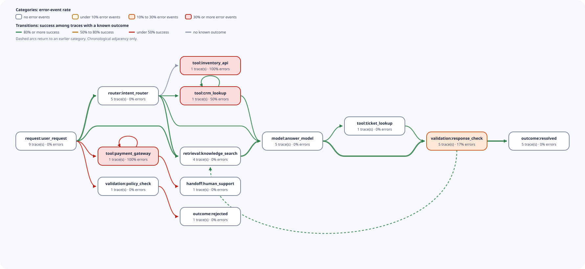

# JourneyGraph

Local-first graph analytics for recurring paths, loops, failures, and outcomes across
AI-agent traces and event data.

> **JourneyGraph does not collect traces. It analyzes the traces and event exports you already
> have.** Core analysis runs locally, needs no account or API key, and sends no telemetry.

**You shipped a new agent version. What changed?** Tracing tools are built to inspect one
execution. JourneyGraph looks across thousands of them: which paths became more common, where
retries, errors, latency, or cost grew, and which steps are associated with failed or handed-off
runs.



Try it without installing JourneyGraph (Python 3.11 or later and [pipx](https://pipx.pypa.io/)):

```bash
pipx run journeygraph demo --output-dir journeygraph-demo
```

Then open `journeygraph-demo/report.html`: ranked key findings first, then the layered graph
above, operation categories, path variants, and recurring sequences, all from synthetic data.

| You want to | Run |
| --- | --- |
| See recurring paths, loops, failures, and findings across many runs | `journeygraph analyze traces.jsonl --output-dir report` |
| Compare a baseline and a candidate release | `journeygraph diff before.jsonl after.jsonl --output-dir diff` |
| Fail CI when journey-level rules regress | `journeygraph check after.jsonl --rules rules.toml --baseline before.jsonl` |
| Bring an export with its own field names | `journeygraph inspect export.jsonl --mapping-out mapping.toml`, then `--mapping mapping.toml` |
| Start from Langfuse, LangSmith, or Arize Phoenix exports | `--preset langfuse-observations`, `langsmith-runs`, or `phoenix-spans` (experimental) |

Everything is deterministic: the same input and options give byte-identical JSON, HTML, and
SVG. Findings and comparisons describe associations and observed differences, never causes.

JourneyGraph is an early alpha with a deliberately narrow, tested contract: canonical JSONL,
CSV, and optional Parquet are stable inputs; mapped and vendor-shaped exports and OTLP/JSON
are experimental. See [Supported inputs](#supported-inputs) and
[Current limitations](#current-limitations-and-non-goals).

## Five-minute quickstart

Python 3.11 or later is required. From a fresh virtual environment, install the published
package and generate a complete synthetic report:

```bash
python3 -m venv .venv && . .venv/bin/activate
python -m pip install journeygraph
journeygraph demo --output-dir journeygraph-demo
```

Open `journeygraph-demo/report.html` in a browser. The command also writes:

```text
journeygraph-demo/
├── analysis.json
├── demo-traces.jsonl
├── graph.svg
├── normalized.jsonl
└── report.html
```

The packaged demo is deterministic and entirely synthetic. Its current output contains 45
events across 9 traces, 13 aggregate nodes, 19 unique transitions, 2 retry categories, and 3
exact return-loop sequences. Outcomes are 5 successes, 1 failure, 1 handoff, and 2 unknown
outcomes. The report opens with 5 ranked key findings and a layered graph colored by error
rate and success.

## Analyze your own export

Canonical JSON Lines contains one operation per line:

```json
{"schema_version":"1.0","trace_id":"trace-1","step_id":"request","timestamp":"2026-07-21T08:00:00Z","operation_type":"request","component":"user_request","duration_ms":4,"status":"ok"}
{"schema_version":"1.0","trace_id":"trace-1","step_id":"answer","parent_step_id":"request","timestamp":"2026-07-21T08:00:00.125Z","operation_type":"outcome","component":"completed","duration_ms":1,"status":"ok","outcome":"success"}
```

Validate first, then produce all four analysis artifacts:

```bash
journeygraph validate traces.jsonl
journeygraph analyze traces.jsonl --output-dir journeygraph-report
```

A compact part of `analysis.json` looks like this for the packaged demo:

```json
{
  "schema_version": "1.2",
  "totals": {
    "events": 45,
    "nodes": 13,
    "traces": 9,
    "transitions": 36,
    "unique_transitions": 19
  },
  "outcomes": {
    "counts": {
      "dropoff": 0,
      "failure": 1,
      "handoff": 1,
      "success": 5,
      "unknown": 2
    }
  }
}
```

Use `--cohort-key environment` to compare retained operational cohorts. Use repeatable
`--allow-metadata-key KEY` options only for additional non-sensitive operational fields.
Sensitive-key rules remain permanent even when a key is requested explicitly. Use
`--min-support N` (default 3) to require more traces or events behind each ranked finding.
Restrict the analysis with `--outcome failure,handoff`, `--since 2026-10-01T00:00:00Z`, or
`--until ...`; the payload records the filters and how many traces they kept.

If your export uses its own field names, describe them in a small TOML mapping instead of
writing a conversion script:

```toml
mapping_version = "1"

[fields]
trace_id = "session.id"
step_id = "span.id"
timestamp = "start_time_unix_ms"
operation_type = "span.kind"
component = 'attributes."tool.name"'
status = "status.code"

[timestamp]
unit = "unix_ms"

[duration]
start = "start_time_unix_ms"
end = "end_time_unix_ms"

[values.status]
STATUS_CODE_OK = "ok"
STATUS_CODE_ERROR = "error"
```

```bash
journeygraph validate export.jsonl --mapping mapping.toml --normalized-out events.jsonl
journeygraph analyze export.jsonl --mapping mapping.toml --output-dir journeygraph-report
```

Only mapped fields are read into events; everything else is ignored and only counted in a
warning. See [field mappings](docs/schema.md#field-mappings).

Exports from Langfuse (enriched observations), LangSmith (run objects from `runs.query`), and
Arize Phoenix (REST span objects) can use a packaged experimental preset instead:
`--preset langfuse-observations`, `--preset langsmith-runs`, or `--preset phoenix-spans`. `journeygraph presets` lists them with their documentation sources.

To start a mapping, let JourneyGraph describe the export and draft one for you to review.
Inspection prints paths, types, and shapes, never values (unless you pass `--show-values`
for short status, outcome, and operation-type tokens):

```bash
journeygraph inspect export.jsonl --mapping-out mapping.toml
```

## Compare releases and gate CI

Compare two exports analyzed with identical options:

```bash
journeygraph diff last-week.jsonl this-week.jsonl --output-dir release-diff
```

`diff.json` and `diff.html` report outcome, category, transition, path-variant, and metric
differences, with a ranked list of notable changes. To fail a CI or evaluation job on
journey-level rules, describe them in TOML and run `check`:

```bash
journeygraph check this-week.jsonl --rules journeygraph-rules.toml \
  --baseline last-week.jsonl --summary-md "$GITHUB_STEP_SUMMARY"
```

`check` exits with code `5` when a rule fails. See [CLI and Python API](docs/cli.md) for the
rule list.

## What it computes

- Aggregate nodes for exact `(operation_type, component)` categories and weighted directed
  chronological-adjacency transitions between steps.
- Complete exact chronological paths with stable SHA-256 identities and frequency/outcome
  summaries.
- Adjacent exact-category repetitions and non-adjacent return sequences, reported separately.
- Reconciled success, failure, handoff, drop-off, and unknown outcomes.
- Technical error events, explicit failure/drop-off points, entries, terminals, and successful
  versus non-successful path comparisons.
- Event-level duration, token, and supplied-cost summaries with explicit missing counts,
  globally and per operation category, plus the outcomes of traces visiting each category
  and transition.
- Path variants that group traces after collapsing consecutive repeated blocks
  (`search+`, `(search → validate)+`), with references to every exact path they merge, and
  recurring two- and three-step sequences with the outcomes of the traces that contain them.
- Up to ten ranked, reproducible key findings: outcome and sequence associations, error hotspots, duration
  and cost concentration, and retry prevalence, each with support, a baseline, and a Wilson
  interval where applicable. Findings are associations, never causes.
- A deterministic layered left-to-right graph colored by error-event rate and by success among
  traces with a known outcome.
- Optional cohort summaries based on retained metadata.
- Structured data-quality and privacy warnings without echoing rejected values.

All ordering, IDs, aggregates, JSON, normalized JSONL, HTML, and SVG are deterministic for the
same accepted input and configuration. Parent links are diagnostics; normalized chronological
order is authoritative, with `step_id` as the equal-timestamp tie-breaker. A trace without an
explicit business outcome is `unknown`; span or event status never invents a business outcome.

## Supported inputs

| Input | Maturity | Boundary |
| --- | --- | --- |
| JSON Lines | Stable canonical v1 | One `journeygraph.event/v1` object per line. |
| CSV | Stable canonical v1 | Same scalar fields; metadata uses `metadata.<key>` columns. |
| Parquet | Optional canonical v1 | Same logical columns through `journeygraph[parquet]` and PyArrow. |
| Mapped JSON Lines, CSV, or Parquet | Experimental | Any record shape with `--mapping FILE`, a declarative TOML field mapping applied before canonical validation. |
| Langfuse observations, LangSmith runs, Arize Phoenix spans | Experimental | `--preset langfuse-observations`, `--preset langsmith-runs`, or `--preset phoenix-spans`: packaged mappings for the vendors' documented export shapes, not tested against real exports. |
| OTLP/JSON | Experimental | Explicit `--format otlp-json`; one uncompressed OTLP/HTTP `ExportTraceServiceRequest` JSON body. |
| OTLP JSON Lines | Experimental | Explicit `--format otlp-jsonl`; OpenTelemetry Collector file-exporter output, one `ExportTraceServiceRequest` per line, decoded with the same mapping. |
| OTLP protobuf | Experimental | Explicit `--format otlp-proto` (one binary OTLP/HTTP request body) or `--format otlp-proto-file` (Collector file exporter `format: proto`, uncompressed); standard-library decoder, same mapping. |

The experimental importer verifies an official OTLP request shape and maps a documented
subset of OpenTelemetry and OpenInference attributes. It is not a collector, live receiver,
gRPC receiver, generic JSON importer, or claim of Langfuse/Phoenix/provider
compatibility. Validate a representative sanitized export before relying on it. See the exact
[data schema and mappings](docs/schema.md) and the reproducible
[instrumented test-data harness](test-data/README.md).

OTLP paths and transitions currently describe chronological adjacency only. Parent links are
validated and reported as diagnostics, but JourneyGraph does not yet reconstruct parent-aware
control flow; concurrent or sibling spans can therefore be adjacent without being sequential.

## Where it fits

For AI systems, a journey might be:

```text
request -> router -> retrieval -> model -> tool -> validation -> outcome
```

The same canonical model also supports non-AI operational journeys such as service workflows,
batch pipelines, product events, support escalation, approval processes, or test-run steps.
JourneyGraph describes observed associations; it does not infer causes or judge quality.

The implementation keeps provider-specific decoding at the ingestion boundary:

```text
local export -> reader -> validation/privacy normalization -> aggregate graph
             -> deterministic analytics -> JSON + normalized JSONL + HTML + SVG
```

The analytical core uses only the Python standard library. Optional PyArrow is isolated to
Parquet ingestion. See [Architecture](docs/architecture.md) for dependency boundaries and
stable identity rules.

## Privacy and security boundary

JourneyGraph denies metadata by default except for a small operational allowlist. Keys matching
the documented sensitive fragments—including prompt, message, document, credential, token,
email, and common identifier names—are permanently excluded. Reports escape untrusted markup;
HTML has no executable JavaScript or remote dependency, and SVG has no scripts or remote
resources.

This is key-based filtering, not content inspection, anonymization, or a DLP system. An
arbitrary custom key or value can still identify someone even when its name does not match the
denylist. Retained IDs, timestamps, labels, allowed values, rare paths, and `normalized.jsonl`
may still be sensitive. Inspect artifacts before sharing them. Read the full [Privacy and
Threat Model](docs/privacy.md).

## Quality and reproducibility

The repository has three test layers: pure unit tests, real-file integration tests, and
black-box installed-CLI functional tests. The acceptance suite covers deterministic ordering,
branches, retries, loops, outcomes, malformed data, duplicates, privacy leakage, hostile
markup, Unicode, output safety, canonical formats, actual instrumented OTLP/JSON samples,
hand-authored OTLP edge cases, and a real Parquet file when the optional dependency is
installed. The committed instrumented samples come from offline OpenInference scenarios and a
pinned official OpenTelemetry Demo capture; they are demo evidence, not production traces or
producer-wide compatibility claims.

The canonical local gate enforces Ruff formatting/linting, strict mypy, combined statement and
branch coverage of at least 90%, an isolated wheel smoke test, documentation contracts,
dependency auditing, Bandit, and secret scanning:

```bash
make setup
make verify
```

Mutation testing and the deterministic 2,000-trace benchmark are explicit additional checks:

```bash
make mutation
make benchmark
```

CI runs the same Make targets on Linux with Python 3.11, 3.12, 3.13, and 3.14. A separate
native Windows job on Python 3.12 builds the distributions, installs the exact wheel in an
isolated environment, and exercises CLI help, CRLF/Unicode validation, deterministic analysis,
and the packaged demo. No remote CI result is claimed until that workflow actually runs. See
[Testing and Quality](docs/testing.md).

## Current limitations and non-goals

- Batch, local, in-memory analysis only; no collection, streaming, server, hosted service, or
  graph database.
- Exact category and path grouping only; no fuzzy clustering, causal inference, prediction,
  anomaly truth, or LLM-as-a-judge.
- OTLP/JSON support is intentionally narrower than the complete protocol and semantic
  convention surface.
- Supplied token and cost values are summarized as-is; provider pricing is not recalculated.
- Whole multi-file publication is not transactional, although each artifact uses guarded
  sibling replacement.
- The installed package and CLI are tested natively on Windows with Python 3.12. Repository
  development commands still use the documented POSIX Makefile harness or WSL.

## Roadmap

Near-term work should be driven by sanitized real-export evidence: upgrade the experimental
importers and presets with real exports, add configurable node keys, improve large-input
behavior (streaming normalization and an optional columnar backend), offer a notebook-friendly
Python API and graph exports, and expand visual navigation without weakening static/local
guarantees. Leakage-safe prefix prediction is a possible later experiment only after temporal
evaluation and privacy safeguards exist.

## Documentation

- [CLI and Python API](docs/cli.md)
- [Data and Analysis Schemas](docs/schema.md)
- [Architecture](docs/architecture.md)
- [Privacy and Threat Model](docs/privacy.md)
- [Privacy-safe real-trace discovery](docs/real-trace-discovery.md)
- [Testing and Quality](docs/testing.md)
- [Product brief](docs/product-brief.md)
- [MVP execution plan](docs/exec-plans/journeygraph-mvp.md)
- [Real-trace discovery execution plan](docs/exec-plans/real-trace-discovery.md)
- [Instrumented OTLP test data](test-data/README.md)
- [Instrumented trace harness execution plan](docs/exec-plans/instrumented-trace-harness.md)
- [PyPI Trusted Publishing preparation](docs/exec-plans/pypi-trusted-publishing.md)
- [Release process](docs/releasing.md)

The experimental standards boundary is anchored to the [OTLP
specification](https://opentelemetry.io/docs/specs/otlp/), pinned [OpenTelemetry protobuf
v1.10.0](https://github.com/open-telemetry/opentelemetry-proto/tree/v1.10.0), and
[OpenInference semantic conventions](https://arize-ai.github.io/openinference/spec/semantic_conventions.html).

## Contributing

Issues and small, evidence-backed changes are welcome. Significant changes to schema meaning,
privacy, stable identities, format compatibility, or architecture need an approved ExecPlan.
Please read [CONTRIBUTING.md](CONTRIBUTING.md), the [Code of Conduct](CODE_OF_CONDUCT.md), and
the [Security Policy](SECURITY.md) before submitting material.

## License

JourneyGraph is available under the [Apache License 2.0](LICENSE).
